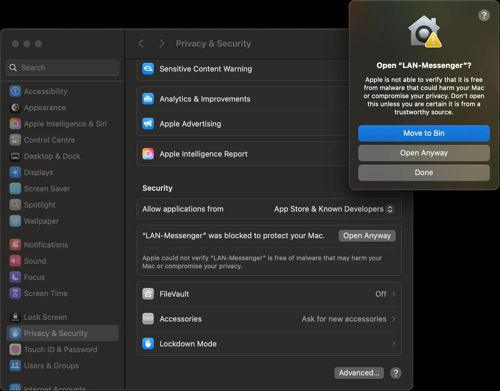

Download the DMG matching your Mac: `lmc_<version>_arm64.dmg` for Apple
Silicon (M-series) or `lmc_<version>_x86_64.dmg` for Intel. Open the DMG
and drag `LAN-Messenger.app` to `/Applications`. In Finder, Launchpad,
and Spotlight the app appears as LAN Messenger (the bundle file keeps
the hyphen).

## First launch is blocked

On the first launch macOS may refuse to open the app with one of these:

- "LAN Messenger can't be opened because Apple cannot check it for
  malicious software."
- "LAN Messenger is damaged and can't be opened."

This is Gatekeeper, not a broken download. The app is ad-hoc signed and
not notarized, so macOS cannot verify the developer identity and errs on
the side of blocking. It happens once per install, not on every launch.

## Allow the app to run

### In Settings (no terminal needed)

1. Try to open the app (double-click it in Finder). macOS blocks it — click Done.
2. Open `System Settings → Privacy & Security` and scroll down to Security.
3. Next to `"LAN-Messenger" was blocked to protect your Mac`, click Open Anyway,
   enter your password, then click Open in the confirmation dialog.



The approval is one-time: afterwards the app launches normally from Spotlight,
Launchpad, or the `/Applications` folder — open it from there to verify.

The Open Anyway button shows for about an hour after the blocked launch
attempt — if it is gone, try opening the app once more. (On macOS before
Sequoia the Ctrl-click → Open workaround in Finder also opened such apps;
since Sequoia, only the Settings path remains.)

### In the terminal

The same approval is one command clearing the quarantine attribute:

```bash
sudo xattr -dr com.apple.quarantine "/Applications/LAN-Messenger.app"
```

After that the app launches normally from Spotlight, Launchpad, or the
`/Applications` folder. To verify right away:

```bash
open "/Applications/LAN-Messenger.app"
```

## What you don't need

- A manual `codesign`: the bundle already carries its signature; signing
  it again locally changes nothing.
- Re-downloading the DMG: the warning is about developer identity, not a
  corrupted file.
- Disabling Gatekeeper system-wide (`spctl --master-disable`): never
  needed for this, and it lowers protection for everything else.

Removing the warning entirely requires an Apple Developer ID and
notarization of every release; until then the one-time approval above is
the supported path.

## If it still doesn't start

Open an [issue](https://github.com/lanmessenger/lanmessenger/issues) with your macOS version, your chip (Apple Silicon or
Intel), the app version, and the exact message text macOS shows.
